# bob baixa

baixador de vídeos para windows. cola um link, vê a miniatura e baixa. o motor é o yt-dlp, com ffmpeg para juntar e converter. na primeira abertura o programa obtém os dois sozinho.

funciona com youtube e com os outros sites do yt-dlp: um vídeo, uma playlist ou um canal.

## baixar

o instalador está nas [releases](https://github.com/goszc/bob-baixa/releases/latest).

[bob-baixa-setup.exe](https://github.com/goszc/bob-baixa/releases/latest/download/bob-baixa-setup.exe)

1. execute o `bob-baixa-setup.exe`
2. o windows pode mostrar o smartscreen, porque o instalador não é assinado. em "mais informações", escolha "executar assim mesmo"
3. deixe marcado o atalho da área de trabalho se quiser
4. abra o bob baixa pelo menu iniciar
5. na primeira vez, com internet, ele baixa o yt-dlp e o ffmpeg (cerca de 100 mb). o windows 11 já traz o webview2. no windows 10, se a janela não abrir, instale o [webview2](https://developer.microsoft.com/microsoft-edge/webview2/)

o programa fica em `%LOCALAPPDATA%\bob baixa`. desinstalar está no menu iniciar, em bob baixa → desinstalar. a pasta de downloads e as configurações não são apagadas.

## telas

claro, escuro, vidro claro e vidro escuro. **seguir o windows** acompanha o modo do sistema. se a última escolha foi vidro, ele usa vidro claro ou vidro escuro.

| | claro | escuro |
|---|---|---|
| início | 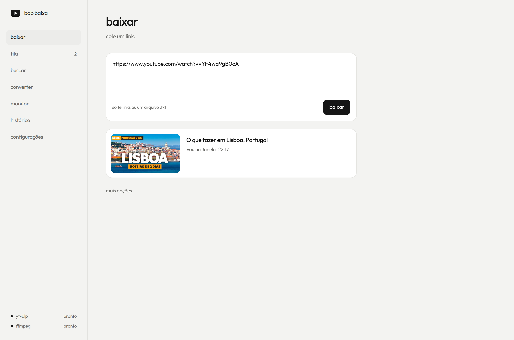 | 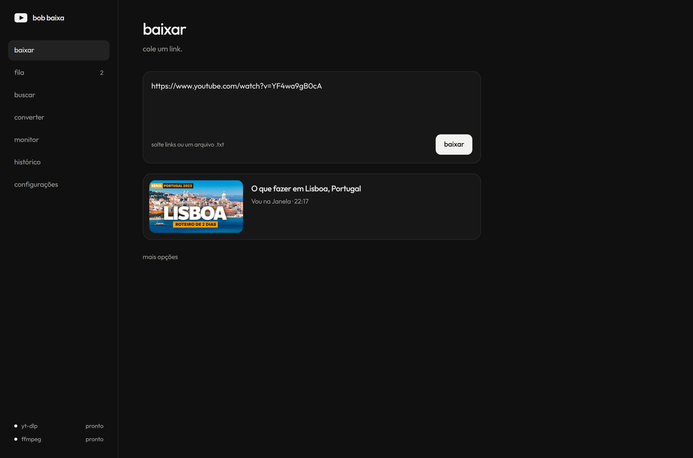 |
| fila | 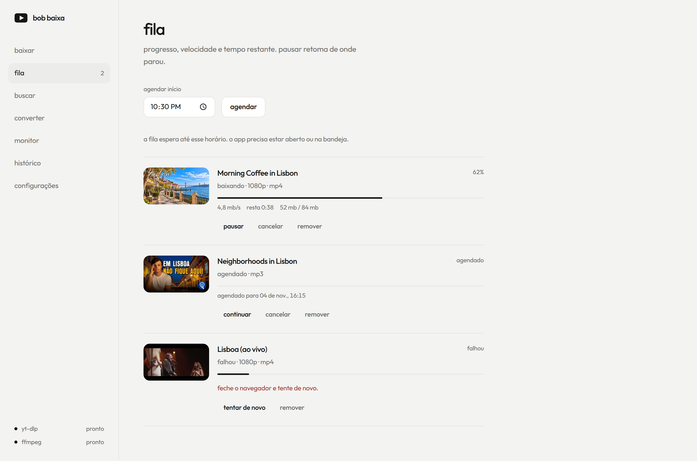 | 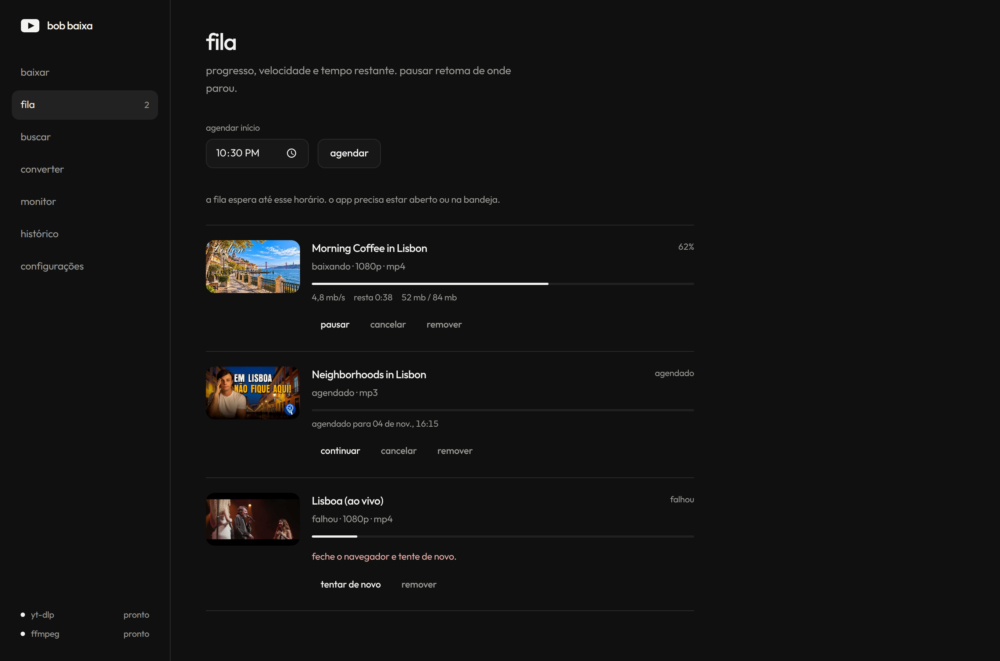 |
| configurações | 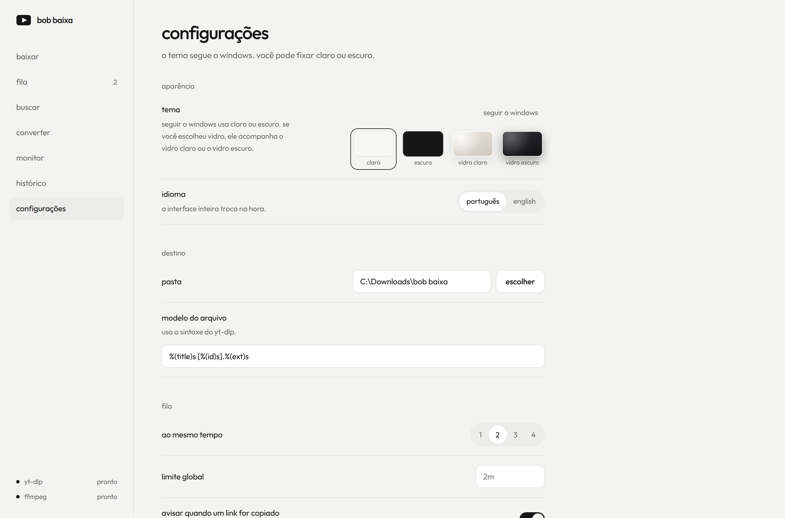 | 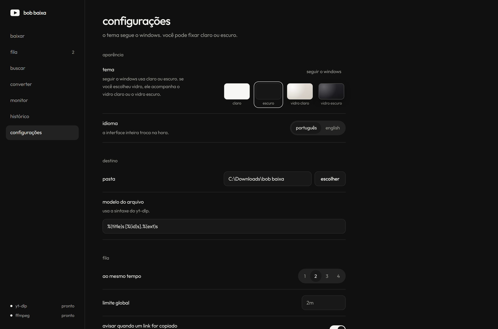 |

| | vidro claro | vidro escuro |
|---|---|---|
| início | 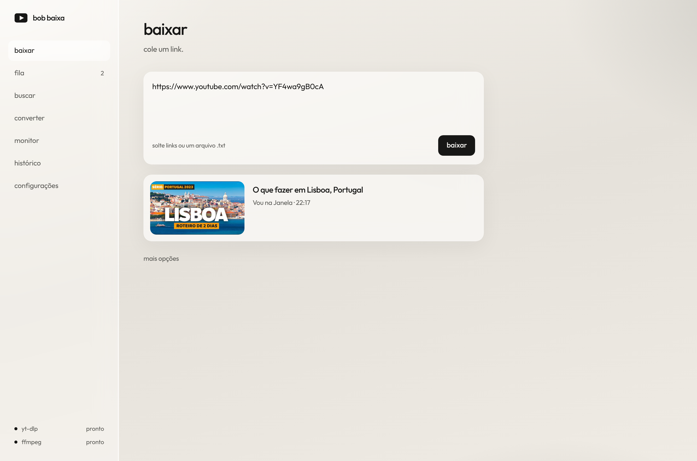 | 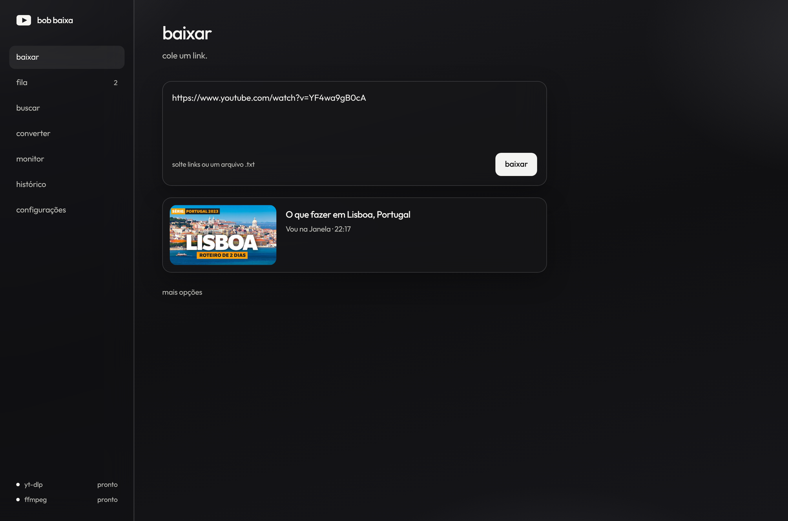 |
| fila | 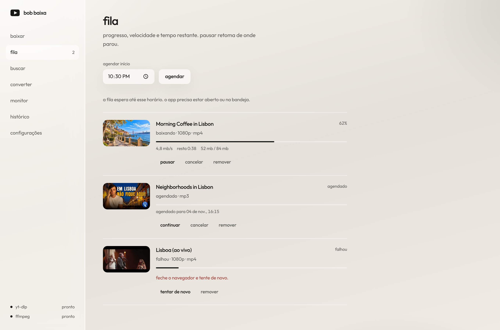 | 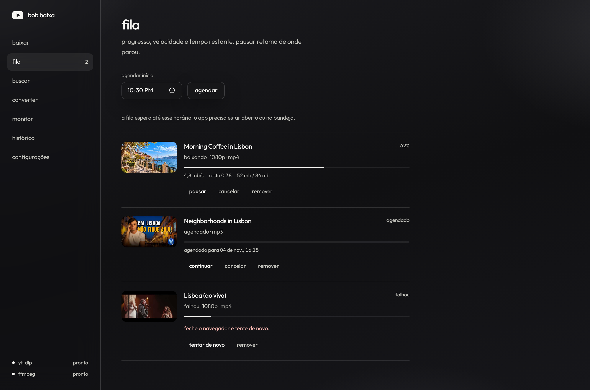 |
| configurações | 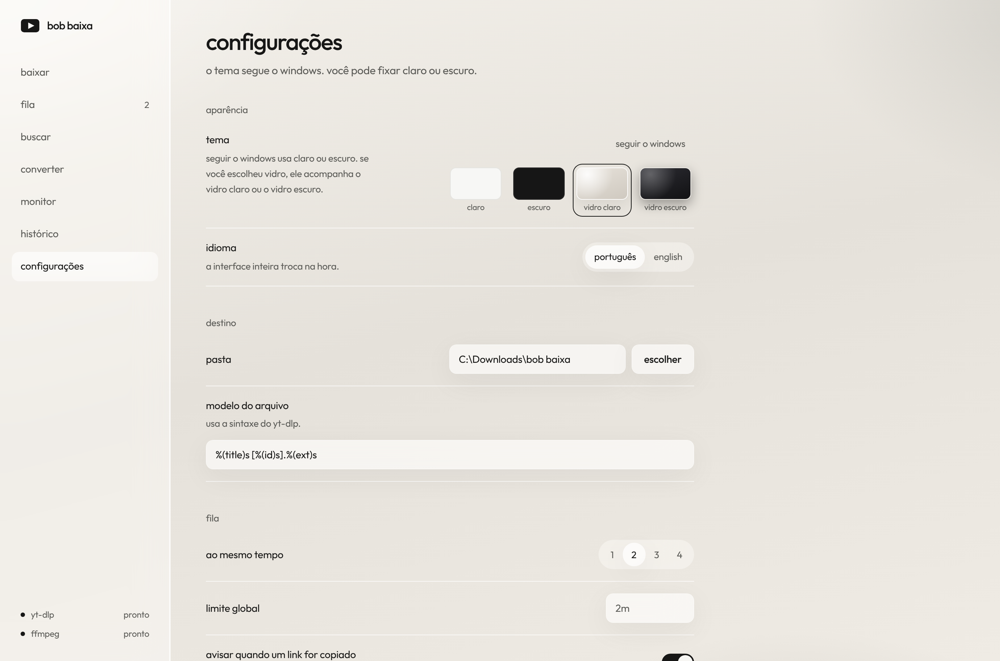 | 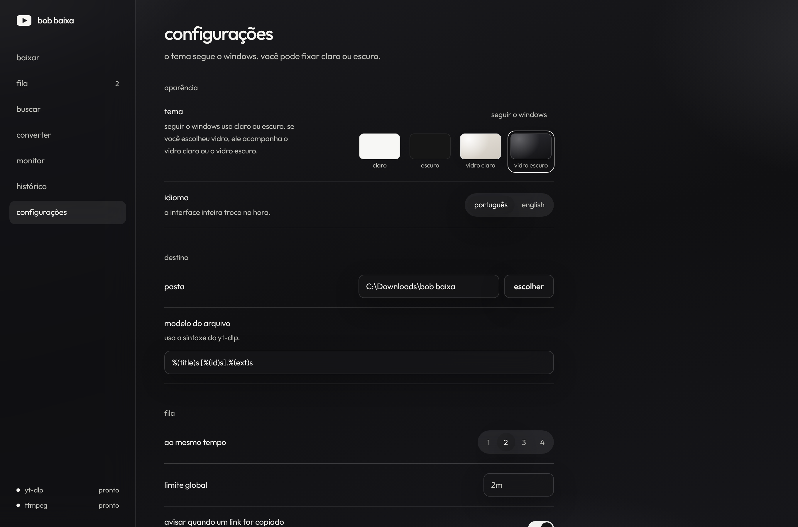 |

## o que faz

- cola um ou vários links. o título e a miniatura aparecem sozinhos. **baixar** manda para a fila em 1080p mp4
- playlists e canais viram vários itens
- qualidade, formato, só áudio (mp3, m4a, opus, flac), recorte (`1:20` até `3:45`) e limite de velocidade
- predefinições de um clique: música mp3, vídeo 4k, vídeo 1080, e as que você salvar a partir das opções atuais
- fila com progresso, velocidade, tempo restante, pausar, continuar, cancelar e tentar de novo
- até 4 downloads ao mesmo tempo. o padrão é 2, em configurações, e a fila respeita isso ao pausar, continuar e tentar de novo
- agendar o início da fila. o app precisa estar aberto ou na bandeja
- buscar no youtube
- converter um arquivo que já está no computador
- monitorar canais e playlists e baixar vídeos novos
- histórico
- player para o que já foi baixado. toca o áudio e o vídeo que estão no disco, sem transmitir o youtube. as letras vêm do arquivo, de um `.lrc` ao lado, do youtube (legenda manual) ou de lrcmux, karalyr, lrclib e lyrics.ovh
- em configurações, a chave do [acoustid](https://acoustid.org/new-application) melhora o nome da faixa, a capa e a letra. sem a chave, o app ainda consulta o musicbrainz pelo título. o pedido fica em um por segundo
- equalizador, karaokê, tradução da letra, mix do dia e cuidados da biblioteca (busca na letra, duplicatas, tags e modo econômico em lote)
- atalhos globais, configuráveis: tocar ou pausar, próxima, anterior e curtir. o `ctrl+shift+b` continua pegando o link copiado
- google drive, quando a compilação inclui o cliente: **entrar com google** em configurações. nada para colar. as faixas sobem para `bob baixa` e tocam de lá. se o botão não aparecer, essa compilação saiu sem o cliente
- legendas, miniatura, metadados, capítulos e sponsorblock
- pasta de destino, modelo do nome e configuração gravada
- cookies em **auto**: se o vídeo pedir login, tenta de novo com o navegador instalado. se o banco de cookies travar, feche o navegador
- `ctrl+shift+b` pega o link copiado e começa a baixar
- menu de contexto, desligado por padrão: **baixar link copiado com bob baixa** no clique direito da área de trabalho ou de uma pasta. no windows 11 pode aparecer em mostrar mais opções. não pede administrador e some ao desligar ou desinstalar
- soltar um link, um `.txt` ou um vídeo na janela
- avisos do windows quando um download termina ou falha
- temas claro, escuro, vidro claro e vidro escuro, além de seguir o windows
- atualização automática do yt-dlp, do ffmpeg e do próprio app

### extensão do chrome e do edge

a pasta `extension` fica ao lado do programa (e neste repositório).

1. abra `chrome://extensions` ou `edge://extensions`
2. ative o modo do desenvolvedor
3. carregar sem compactação e escolha a pasta `extension`

na página de um vídeo do youtube aparece **baixar com bob baixa**. o app escuta em `http://127.0.0.1:47821` e no protocolo `bobbaixa://`.

## atualizações

com **atualizar sozinho** ligado (é o padrão), o app:

- ao abrir e a cada 3 horas, roda `yt-dlp -U` em silêncio
- confere o ffmpeg nas versões do [BtbN/FFmpeg-Builds](https://github.com/BtbN/FFmpeg-Builds/releases) e baixa de novo se a publicação for mais nova
- se um download falhar com erro de extrator, atualiza o yt-dlp e tenta outra vez
- consulta [latest.json](https://github.com/goszc/bob-baixa/releases/latest/download/latest.json). se houver versão nova e a assinatura bater com a chave pública, mostra **nova versão disponível. reiniciar?**
- depois de atualizar, abre **o que há de novo** uma vez. o mesmo texto está em configurações e no `CHANGELOG.md`

em configurações, **verificar agora** faz a mesma checagem na hora. o campo **endereço das atualizações** só precisa ser preenchido se você publicar o manifesto em outro lugar.

### publicar uma versão

a chave pública está em `packaging/updater.pub`. a chave privada não entra no git. ela não tem senha.

1. no github, abra o repositório **goszc/bob-baixa**
2. **settings** → **secrets and variables** → **actions** → **new repository secret**
3. nome: `TAURI_SIGNING_PRIVATE_KEY`
4. valor: o conteúdo inteiro do arquivo da chave privada (uma linha começando com `dW50cnVzdGVkIGNvbW1lbnQ6`)
5. suba a versão em `package.json`, `src-tauri/tauri.conf.json`, `src-tauri/Cargo.toml`, `crates/bob-core/Cargo.toml` e no `DisplayVersion` de `packaging/bob-baixa.nsi`
6. escreva a seção dessa versão no `CHANGELOG.md` (o título é `## 0.2.0`, por exemplo)
7. envie uma tag `v0.2.0` (ou a próxima). o workflow `.github/workflows/windows.yml` gera o instalador num runner windows, assina com `tauri signer sign`, usa a seção do changelog como texto da release e como `notes` do `latest.json`, e publica `bob-baixa-setup.exe` e `latest.json`

sem esse segredo, o workflow ainda gera o instalador, mas não publica o manifesto assinado. uma atualização sem assinatura válida é ignorada.

o botão **entrar com google** só existe se a compilação recebeu `BOB_GOOGLE_CLIENT_ID` e `BOB_GOOGLE_CLIENT_SECRET` (segredos do actions com esses nomes, cliente oauth desktop do app, escopo `drive.file`). quem usa o programa não cria cliente nem cola id. sem os dois segredos o instalador sai normal e o drive fica escondido.

## compilar

precisa de rust estável, node 22 e, para o instalador, o nsis.

no windows:

```bash
npm ci
npm run tauri build -- --no-bundle
cd packaging
makensis /DEXE=..\target\release\bob-baixa.exe /DEXTDIR=..\extension /DICON=..\src-tauri\icons\icon.ico bob-baixa.nsi
```

o instalador sai em `packaging/bob-baixa-setup.exe`.

no linux, o mesmo binário windows com o alvo msvc:

```bash
sudo apt install nsis lld llvm clang
rustup target add x86_64-pc-windows-msvc
cargo install --locked cargo-xwin
npm ci
npm run tauri build -- --runner cargo-xwin --target x86_64-pc-windows-msvc --no-bundle
cd packaging
makensis -DEXE=../target/x86_64-pc-windows-msvc/release/bob-baixa.exe -DEXTDIR=../extension -DICON=../src-tauri/icons/icon.ico bob-baixa.nsi
```

testes do motor:

```bash
cargo test -p bob-core
```

interface em desenvolvimento:

```bash
npm run tauri dev
```

yt-dlp e ffmpeg não vão dentro do instalador. o app baixa a versão atual na primeira execução.

## licença

mit. o texto está em [LICENSE](LICENSE).
